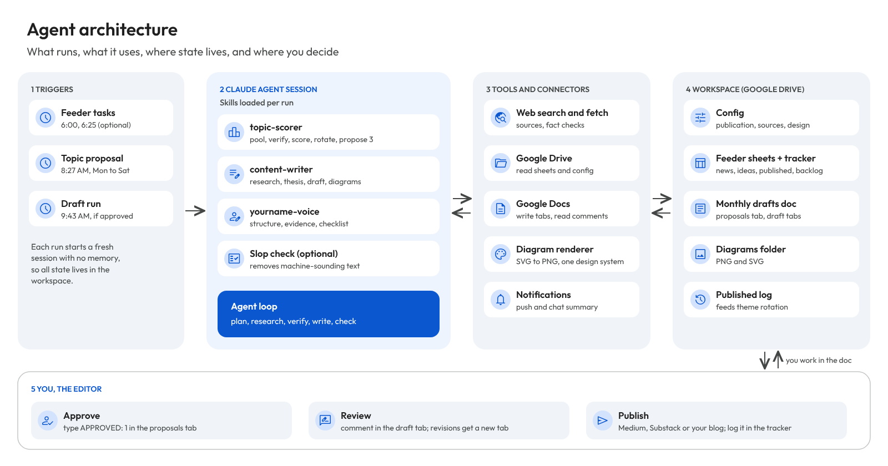
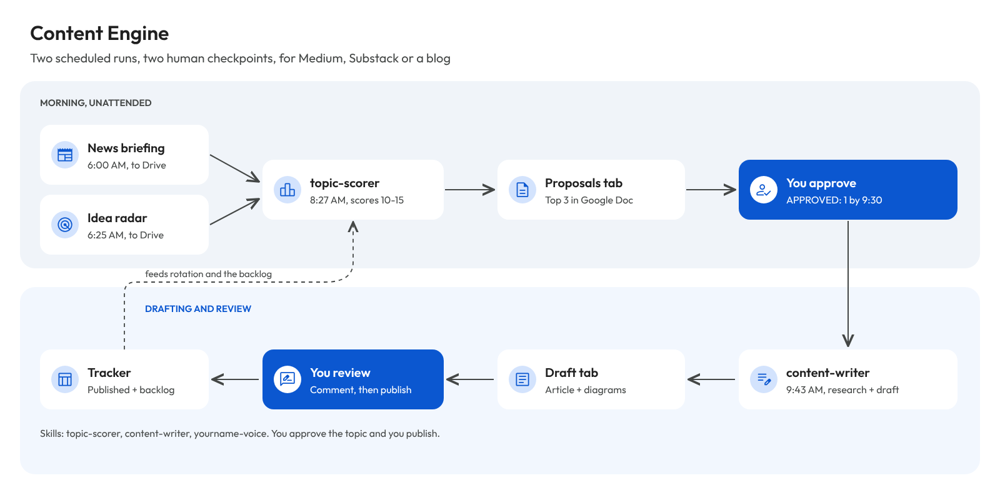
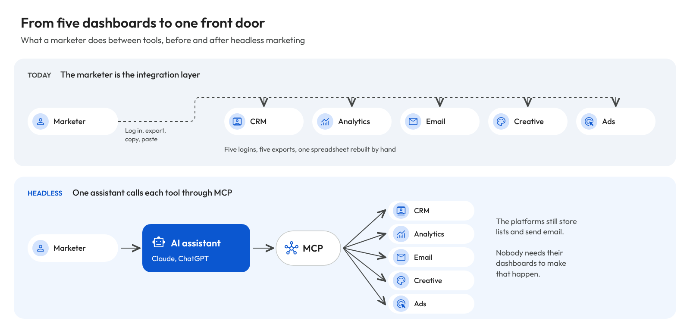
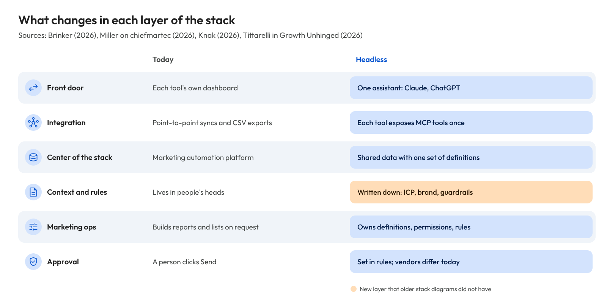
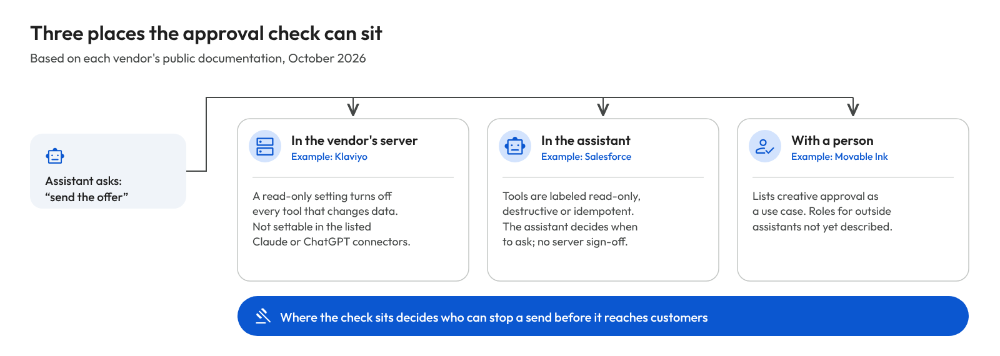

# Content Engine

**An AI editorial pipeline for writers who publish on Medium, Substack or their own blog. Every morning it finds and scores topics, drafts the one you approve with sources and diagrams, and leaves every decision to you.**

I built it to run my own Medium blog on GTM, product management and enterprise AI. Writing well every day takes more research time than I have, so the engine does the research and the first draft, and I stay the editor. This repo is the generic version: three skills, two scheduled task prompts and the templates to set it up for your own publication.

It runs on Claude skills and scheduled tasks, with Google Drive and Google Docs as the workspace.

## Agent architecture



The engine has five parts. Read the image left to right:

| Part | What it is | Why it is built this way |
|---|---|---|
| 1. Triggers | Claude scheduled tasks: optional feeders, the topic proposal, the draft run | Writing on a schedule is the point; each run is unattended |
| 2. Claude agent session | A fresh session per run that loads the skills it needs and works through plan, research, verify, write, check | Skills keep the instructions versioned and reusable; a fresh session keeps runs independent |
| 3. Tools and connectors | Web search and fetch, Google Drive, Google Docs, a diagram renderer, notifications | Each tool does one job; the agent combines them per task |
| 4. Workspace | Google Drive: config, feeder sheets, tracker, the monthly drafts doc, diagrams, published log | Runs have no memory of each other, so everything they share lives here |
| 5. You | Approve in the proposals tab, review in the draft tab, publish | The engine proposes and drafts; you decide and publish |

## How a day runs



| Time | What happens | Who |
|---|---|---|
| 6:00 AM | Optional: a news briefing is saved to Drive as a sheet | Scheduled task |
| 6:25 AM | Optional: an idea radar is saved to Drive as a sheet | Scheduled task |
| 8:27 AM | `topic-scorer` builds 10 to 15 candidates, verifies the leaders and proposes 3 in the day's Google Doc tab | Scheduled task |
| By 9:30 AM | You type `APPROVED: 1` (or 2, 3, or your own topic). No mark means no draft | You |
| 9:43 AM | `content-writer` researches, drafts in your voice, renders diagrams and puts the article in its own tab | Scheduled task |
| Afternoon | You review with comments. Revisions go into a new tab so your comments stay in place | You and Claude |
| When ready | You publish and log it in the tracker, which feeds theme rotation | You |

## What is in this repo

```
skills/
  topic-scorer/      finds, verifies and scores topics; proposes three
  content-writer/    researches and drafts the approved topic; renders diagrams
  yourname-voice/    template for YOUR voice: rename it and fill it in
tasks/               the two scheduled task prompts, with placeholders
config/              publication settings, sources, diagram design system
tracker/             layout of the Published and Backlog tracker sheet
examples/diagrams/   sample diagrams from a real draft
docs/images/         agent architecture and daily flow images
```

Every folder in `skills/` is a complete Claude skill (`SKILL.md`). The README is the front page of the whole repo; each `SKILL.md` is the instruction file Claude actually loads when that skill runs.

## Set it up for your publication

1. **Make your voice skill.** Copy `skills/yourname-voice`, rename it (for example `priya-voice`), and replace every placeholder. Paste two or three of your best paragraphs in `references/samples.md`.
2. **Fill in `config/publication.md`:** platform, themes, schedule, time zone, Drive folders and doc format. Then `config/sources.md` and `config/design.md`.
3. **Install the skills** in your Claude account: `topic-scorer`, `content-writer` and your voice skill. A slop-removal skill is a useful extra.
4. **Create the Drive workspace:** a root folder, a drafts folder, a diagrams folder, and the tracker sheet from `tracker/LAYOUT.md`. Copy the two config files into the root folder so scheduled runs can read them.
5. **Create the two scheduled tasks** from `tasks/`, replacing the placeholders with your folder IDs, skill names and time zone.
6. **Run it once by hand,** approve a topic, review the draft, and write what you change back into your voice skill.

## Design decisions

- **You stay the editor.** The system proposes and drafts. You approve every topic and publish every post. Nothing is published automatically.
- **Approval is a line in the document.** A scheduled run cannot wait for a chat reply, so approval is a marker in the day's tab. No marker, no draft.
- **Feeders write to Drive.** Each scheduled run starts fresh, so the optional morning briefing and idea radar save sheets the scorer can read. If they are missing, the scorer researches directly.
- **Blocked sources get substitutes, never workarounds.** No scrapers, caches or mirrors. The run records what it used instead.
- **Theme rotation.** A penalty when one theme dominates recent posts, so the publication keeps its range.
- **The article alone in its tab.** Review notes come separately, so the document holds only what will be published.
- **No invented experience.** The engine never writes first-person stories, results or quotes you did not give it.

## What I learned building it

My first drafts from the engine read like AI writing. My review comments turned into rules, and these are the headlines:

1. **A title is a promise.** The article has to answer it: what changes, and who benefits. News about vendors is evidence, not the structure.
2. **Headings carry the argument.** Labels like "What changed" tell a reader nothing; every heading should state a claim.
3. **The worst slop is a sentence that sounds finished but names nothing.** Naming the product, the request and the person fixed more than any banned-word list.
4. **Every benefit needs a number or a named case,** from practitioners and analysts as well as vendors.
5. **Diagrams need one design system,** applied to every image, so a reader can scan them.
6. **Review is part of the system.** Comments in the doc, revisions in new tabs, and lessons written back into the skills make each draft start better than the last.

The skills here carry these rules in generic form. My own voice profile, design kit and the detailed editing playbook stay private.

## Examples

Diagrams from the first article the engine drafted for my Medium blog:

| | |
|---|---|
|  |  |
|  | |

## Status

v0.3, October 2026. Running daily on my Medium blog. Next: placing images in the doc automatically, and reading engagement data back into topic scoring.

## About

Built by Abhineet Gupta (Abhi), AI drive GTM, Product Marketing, Growth and Product consultant.

## License

[CC BY-NC 4.0](https://creativecommons.org/licenses/by-nc/4.0/), with one added permission.

- **You can** use, share and adapt the skills, templates and images, with credit to "Content Engine by Abhineet Gupta" and a link to this repo.
- **You can** use the engine to write and publish your own content, including paid newsletters and monetized blogs.
- **You need written permission** to sell it, resell it, or offer it, or anything built on it, to others as a product or paid service.

See [LICENSE](LICENSE) for the full terms.
